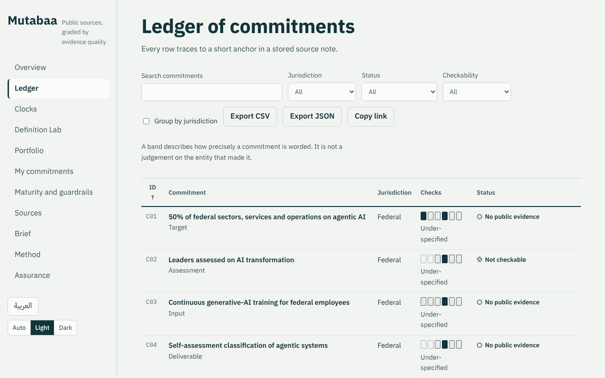
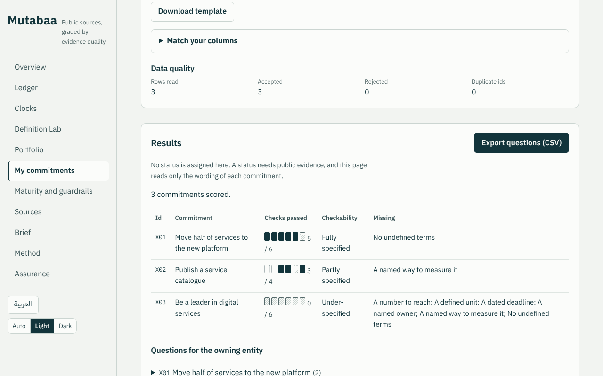
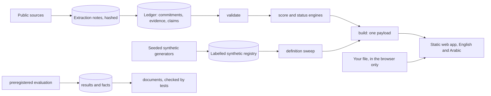

# Mutabaa · متابعة

**A verifiability workbench for UAE and Abu Dhabi AI transformation targets.** A student prototype and a proposal seed, not a deployment and not an official tool.

*Mutabaa* (متابعة) is Arabic for "follow up" or "monitoring".

## The problem

Public AI transformation targets in the UAE set percentages and deadlines that leaders will be assessed on. Several key terms ("agentic", "service", "50%") have no published operational definition, and public progress claims are not graded by the quality of their evidence. From outside the owning entity, many targets cannot yet be checked.

## What it does

- **Ledger.** Public commitments with a six check verifiability score (a number, a unit, a dated deadline, an owner, a way to measure, no undefined terms) and the questions to put to the owning entity.
- **Status with a neutral default.** Written rules applied to graded public evidence. "No public evidence" never means "not done", and media only evidence never moves a status.
- **Definition Lab and Portfolio.** Recompute a headline "% agentic" under every definition on a labelled synthetic registry or on your own file, and see how much entity rankings move.
- **My commitments.** Load an office's own commitments (CSV or JSON). Each is scored with the same checks and gets questions in English and Arabic. The file stays in the browser.
- **Assurance and evaluation.** Exploratory analyses on the Assurance page, and preregistered experiments in [`docs/EVALUATION.md`](docs/EVALUATION.md): <!-- fact:evaluation.hits -->18<!-- /fact --> of <!-- fact:evaluation.predictions -->22<!-- /fact --> predictions hit (three experiments on the real ledger, three on synthetic or simulated data), <!-- fact:evaluation.misses -->4<!-- /fact --> missed, and the misses are reported.

The real ledger holds <!-- fact:commitments.count -->25<!-- /fact --> commitments from <!-- fact:sources.count -->14<!-- /fact --> public sources (<!-- fact:sources.official -->10<!-- /fact --> official, <!-- fact:sources.media -->4<!-- /fact --> secondary media), <!-- fact:evidence.count -->10<!-- /fact --> evidence items and <!-- fact:claims.count -->5<!-- /fact --> media claims held apart from status. <!-- fact:sources.verified -->11<!-- /fact --> sources were verified against the live page; <!-- fact:sources.unreachable -->3<!-- /fact --> could not be reached and are reported as unreachable.

## What this is not

- Not a measurement of any real entity. The registry used by the Definition Lab and the Portfolio is **synthetic** and labelled on every screen.
- Not an assessment of government performance. A status describes public evidence, not delivery.
- Not endorsed by, produced with, or affiliated with any entity. In prose, real entities are named only in [`docs/CONTEXT.md`](docs/CONTEXT.md); the data files quote their sources as published.
- Not an official standard. The maturity ladder and the checks are proposals.



## Score your own commitments

In the browser, open **My commitments** and choose a CSV or JSON file. Nothing is uploaded. From a terminal:

```bash
mutabaa template > commitments.csv
mutabaa questions commitments.csv --lang both
mutabaa score commitments.csv --strict --min-ratio 0.5    # exit code 1 when a gate is not met
```



See the [user guide](docs/USER_GUIDE.md) and the [command line reference](docs/CLI.md).

## Run it

Needs Python 3.12 or newer and Node 22 or newer. From a fresh clone:

```bash
python -m pip install -e ".[dev]"
python -m pipeline validate && python -m pytest --cov=pipeline
cd site && npm ci && npm test && npm run build
```

Then `npm run dev` inside `site/` serves the app locally. `make reproduce` runs the full check, including a rerun of the preregistered evaluation and the browser tests.

## How it fits together



Python is the reference implementation. The browser mirrors only the sweep, the portfolio ranking, the score and the questions, and golden files in `data/golden/` keep each of them identical to Python. See [`docs/ARCHITECTURE.md`](docs/ARCHITECTURE.md).

## Data: what is real, what is synthetic

| Data | Type | Notes |
|---|---|---|
| Commitments, evidence, claims | **Real, public** | Official sources first; secondary media graded lower and flagged |
| Service and operation registry | **Synthetic** | Generic archetypes, never real entity names; every record `is_synthetic: true`; badged in the UI |
| Uploaded files | **Your data** | Processed in the browser only; never sent anywhere |

Real and synthetic numbers are never combined into one figure. See [`docs/DATA_STATEMENT.md`](docs/DATA_STATEMENT.md).

## Project status

| Component | Status | Tag |
|---|---|---|
| Plan, schemas, tooling, CI | done | `v0.0.1-plan`, `v0.1.0` |
| Real ledger, evidence, claims and validation | done | `v0.2.0` |
| Scoring and status engines | done | `v0.3.0` |
| Synthetic registry and sensitivity engine | done | `v0.4.0` |
| Web workbench in English and Arabic | done, Arabic not yet reviewed by a native speaker | `v0.5.0` to `v0.7.0` |
| Blind second extraction | done | `v1.0.0` |
| Live verifier, search log, offline build, security and browser tests | done | `v1.1.0`, `v1.2.0` |
| Robustness, calibration, agreement, Assurance page | done, labelled exploratory | `v1.3.0` |
| Portfolio view, pilot plan, risks, sources policy, corrections, compliance mapping | done | `v1.4.0` |
| Voice and identity rules, facts checked against documents, layer and schema contracts, coverage gate, decision records, preregistered evaluation, My commitments | done | `v1.5.0` |
| Human review of extraction notes and Arabic; a person labelled gold set; legal reading of the sources policy; a real pilot | open | |

## Documents

[`docs/USER_GUIDE.md`](docs/USER_GUIDE.md), [`docs/CLI.md`](docs/CLI.md) and [`docs/PERFORMANCE.md`](docs/PERFORMANCE.md) for use. For the method, [`docs/LIMITATIONS.md`](docs/LIMITATIONS.md) first. Then [`docs/METHODOLOGY.md`](docs/METHODOLOGY.md), [`docs/EVALUATION.md`](docs/EVALUATION.md), [`PREREGISTRATION.md`](PREREGISTRATION.md), [`docs/ARCHITECTURE.md`](docs/ARCHITECTURE.md), [`docs/adr/`](docs/adr/README.md), [`docs/DATA_STATEMENT.md`](docs/DATA_STATEMENT.md), [`docs/CONTEXT.md`](docs/CONTEXT.md), [`docs/SECURITY.md`](docs/SECURITY.md), [`docs/PILOT.md`](docs/PILOT.md) and [`docs/DECISIONS.md`](docs/DECISIONS.md).

## Commands

`mutabaa --help` lists them all; [`docs/CLI.md`](docs/CLI.md) describes each. The repository commands are
`validate`, `build`, `analyse`, `evaluate`, `facts`, `sync-docs`, `schema`, `golden`, `verify-live` and `diff`.
`cd site && npm run build:offline` writes one HTML file that opens from a USB stick.

## Principles

1. **Neutral by default.** Every commitment starts at "no public evidence".
2. **Grounded.** Every real field links to a source; anchors and hashes are checked by machine.
3. **Deterministic.** No model judgement at runtime; every random step takes a seed.
4. **Honest about limits.** Synthetic data is labelled; the rubric is labelled a proposal; analyses run after the design are labelled exploratory.

## Licence

Code: MIT. Dataset (`data/real`, `data/synthetic`): CC BY 4.0. Source material remains the property of its publishers; this repository stores URLs, retrieval dates and short anchors, not republished text.

## Author

Huda Mueen. An independent student project on UAE government AI transformation targets.
