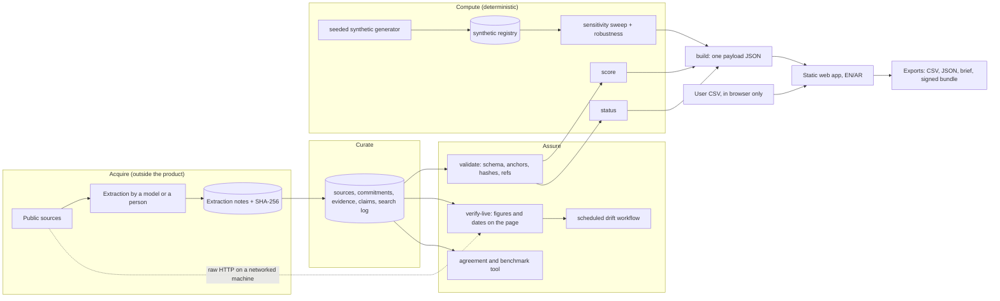

# System architecture

## 1. Principles
- Static core. No runtime model, no runtime network call, no secrets. The browser is the only runtime.
- One source of truth for rules: Python is the reference. TypeScript mirrors only what the browser must recompute, and a golden file keeps them identical.
- Every claim traces to a source, a date and a check. Every number on screen can be recomputed from files in the repository.
- Real and synthetic data never share a number.

## 2. Data flow

## 3. Components

| Component | Where | Responsibility | Depends on |
|---|---|---|---|
| Schemas | `pipeline/schemas.py` | The contract for every record. Synthetic flag is a literal true | pydantic |
| Validator | `pipeline/validate.py` | Integrity: references, anchors, hashes, source-kind rules | schemas |
| Live verifier | `pipeline/verify_live.py` | Fetch each URL and check expected figures and dates on the raw page | network, stdlib only |
| Scoring | `pipeline/score.py` | Six checks per commitment, bands | schemas |
| Status | `pipeline/status.py` | Neutral-by-default status, evidence eligibility | schemas |
| Own file reader | `pipeline/own.py` | Reads a CSV or JSON commitments file, same rules as the site | none |
| Synthetic generator | `pipeline/synth.py` | Seeded labelled registry, scenario presets | none |
| Sensitivity | `pipeline/sensitivity.py` | Sweep over every definition | synthetic |
| Analysis | `pipeline/agreement.py`, `pipeline/calibration.py`, `pipeline/robustness.py` | Exploratory analyses: agreement, score calibration, robustness | engines |
| Preregistered evaluation | `pipeline/evaluate.py`, `pipeline/evaluate_real.py`, `pipeline/synth_b.py` | Experiments fixed in `PREREGISTRATION.md` | engines |
| Facts and reports | `pipeline/facts.py`, `pipeline/render.py` | Numbers that documents may cite; rendered reports | analysis |
| Schema export | `pipeline/schema_export.py` | JSON Schema files generated from the pydantic models | schemas |
| Builder | `pipeline/__main__.py` | One payload for the site | all above |
| Engine mirror | `site/src/engine.ts` | Recompute sweep on user data in the browser | golden file |
| App | `site/src` | Pages, i18n, exports, local workspace | payload |

## 4. Deployment profiles

| Profile | Shape | Network | Who |
|---|---|---|---|
| A. Public demo | Static site on a CDN | Public | Anyone; synthetic and public data only |
| B. Office intranet | The same static build served inside the network, fonts and assets self hosted | None outbound | An analyst team with its own service inventory (CSV stays in the browser) |
| C. Team service (design only) | API plus database in a sovereign cloud region, single sign-on, review workflow, audit log; the static app is its client | Internal | An office with several reviewers and many entities |

Profile C keeps the same schemas, the same engines and the same payload format. What it adds: identity, persistence, review states for each evidence item, an append only audit log, scheduled live verification, and entity level access control.

## 5. Trust boundaries and threats (summary; full table in `docs/SECURITY.md`)
- User CSV: parsed in the browser, never transmitted. Threat: malformed or hostile files. Mitigation: strict parser, size cap, no formula evaluation, no HTML injection (React escapes).
- Source pages: treated as untrusted data. Threat: a page changes or is replaced. Mitigation: figure token checks, drift workflow, hashes of notes.
- Supply chain: pinned and locked dependencies, SBOM, audit in CI.
- Hosting: strict CSP, no third party requests, no cookies.

## 6. Python layers and the import contract

The reference implementation is split into five layers. A module may import modules in its own layer or a lower one, never a higher one. `tests/test_layers.py` parses every file in `pipeline/` with `ast` and fails on an upward import or on a module that has no layer.

| Layer | Modules | May import |
|---|---|---|
| 0. Contracts and pure helpers | `schemas`, `stats`, `render` | nothing from the package |
| 1. Repository input | `io` | layer 0 and its own layer |
| 2. Engines | `score`, `status`, `questions`, `sensitivity`, `synth`, `synth_b`, `own`, `validate`, `verify_live`, `diff` | layers 0 and 1 and its own layer |
| 3. Analysis and reporting | `robustness`, `calibration`, `agreement`, `facts`, `evaluate`, `evaluate_real`, `schema_export` | layers 0 to 2 and its own layer |
| 4. Command line | `__main__` | everything |

Engines hold the rules. Analysis code measures the rules and never changes them. The command line only wires layers together and writes files.

## 7. Generated contracts

`python -m pipeline schema` writes JSON Schema files to `schema/` from the pydantic models. `tests/test_schema.py` fails when a file is stale, and checks that the TypeScript types in `site/src/types.ts` use exactly the field names of the shared models.
